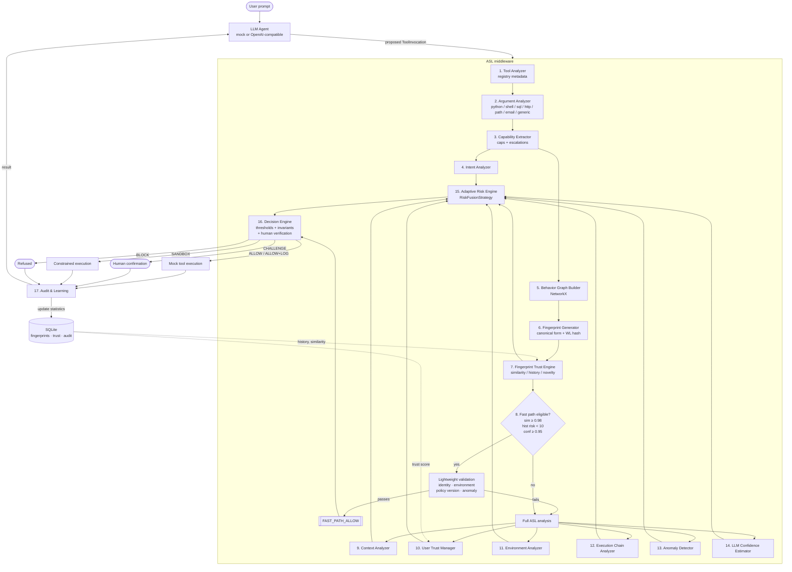
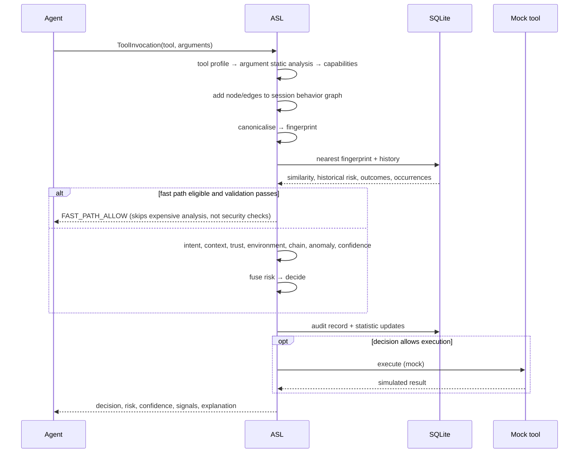

# ASL — Adaptive Security Layer

**Adaptive Runtime Authorization for Safe Tool Invocation in Agentic AI Systems**

This document is the design that the implementation follows: architecture summary,
directory tree, data flow, database schema and class responsibilities. It is written
before/alongside the code so that deviations are visible and justified.

---

## 1. Architecture summary

ASL is middleware that sits between an LLM agent and its tools and authorizes every
proposed tool call *before* it executes:

```
User → LLM Agent → Proposed Tool Call → ASL → Tool → Audit/Learning
```

It is model-agnostic (the agent may be the bundled mock LLM, an OpenAI-compatible
endpoint, or anything else — ASL only sees `ToolInvocation` objects) and it never
executes what it inspects.

### The core claim

Tool-level policies cannot express the difference between
`filesystem.delete("temp.txt")` and `filesystem.delete("/production/database/")`, and
they cannot see that `shell.execute("rm -rf /production/database")` is the *same
action* as the second one. ASL therefore reasons in three layers:

| Layer | Question | Produced by |
|---|---|---|
| Tool | what power does this tool have? | `ToolAnalyzer` (registry metadata) |
| Argument | what is it actually being asked to do? | `ArgumentAnalyzer` (static analysis per payload type) |
| Behavior | how does this relate to what came before, and have we seen this shape before? | `BehaviorGraphBuilder` + `FingerprintGenerator` + trust store |

A **behavioral fingerprint** is a deterministic, *tool-name-free* canonicalisation of
the behavior graph. Two workflows that do the same thing produce the same fingerprint
even when they use different tools; that is what makes trust transferable across tools
and what makes the fast path possible without whitelisting tool names.

### Design commitments

1. **Fingerprints never authorize on their own.** A previously trusted fingerprint is
   evidence, not permission. The fast path still validates identity, environment,
   policy version and anomaly state, and hard invariants (production destruction,
   credential access, privilege escalation, exfiltration chains) can never be
   reached by the fast path.
2. **Risk fusion is not an average.** Worst-signal floors plus bounded corroboration
   premiums, so a CRITICAL finding cannot be diluted by benign ones.
3. **The weighted fusion model is a baseline, not the contribution.**
   `RiskFusionStrategy` is an interface; `WeightedRiskFusion` is the first
   implementation, with `AdaptiveRiskFusion`, `GraphRiskPropagation` and
   `LearnedRiskFusion` as planned comparators. The research contribution is the
   fingerprint-mediated adaptive authorization, and the evaluation isolates it by
   ablation (ASL with and without fingerprinting).
4. **Uncertainty raises risk, never lowers it.** Unknown tools, unparsable payloads,
   obfuscated code and analyzer disagreement all reduce confidence *and* push toward
   human verification.
5. **Nothing dangerous is ever executed.** All tools are mocks over in-memory state.

### Pipeline stages

| # | Stage | Module | Status |
|---|---|---|---|
| 1 | Tool Analyzer | `app/analyzers/tool_analyzer.py` | implemented |
| 2 | Argument Analyzer | `app/analyzers/argument_analyzer.py` + `app/analyzers/arg/*` | implemented |
| 3 | Capability Extractor | `app/behavior/capability_extractor.py` | implemented |
| 4 | Intent Analyzer | `app/analyzers/intent_analyzer.py` | implemented |
| 5 | Behavior Graph Builder | `app/behavior/graph_builder.py` | implemented |
| 6 | Fingerprint Generator | `app/behavior/fingerprint.py` | implemented |
| 7 | Fingerprint Trust Engine | `app/trust/fingerprint_store.py` | implemented |
| 8 | Fast Path | `app/trust/fast_path.py` | implemented |
| 9 | Context Analyzer | `app/analyzers/context_analyzer.py` | implemented |
| 10 | User Trust Manager | `app/analyzers/trust_analyzer.py`, `app/trust/trust_memory.py` | implemented |
| 11 | Environment Analyzer | `app/analyzers/environment_analyzer.py` | implemented |
| 12 | Execution Chain Analyzer | `app/analyzers/execution_chain.py` | implemented |
| 13 | Anomaly Detector | `app/analyzers/anomaly_detector.py` | implemented |
| 14 | LLM Confidence Estimator | `app/analyzers/confidence.py` | implemented |
| 15 | Adaptive Risk Engine | `app/core/risk_engine.py` | implemented |
| 16 | Decision Engine | `app/core/decision_engine.py` | implemented |
| 17 | Audit & Learning | `app/audit/logger.py` | implemented |

---

## 2. Directory tree

```
asl/
├── app/
│   ├── main.py                     # `python -m app.main` serves API + UI; --cli for terminal
│   ├── agent/
│   │   └── mock_agent.py           # ADDED: prompt -> tool calls (+ optional LLM adapter)
│   ├── api/
│   │   ├── routes.py               # /evaluate /health /fingerprints /audit + UI endpoints
│   │   └── static/                 # the inspector UI (index.html, app.js, styles.css)
│   ├── core/
│   │   ├── config.py               # every threshold and weight lives here
│   │   ├── pipeline.py             # ADDED: wires stages 1-6 into a CallInsight
│   │   ├── engine.py               # ADDED: full orchestration + the animatable trace
│   │   ├── risk_engine.py          # RiskFusionStrategy + WeightedRiskFusion baseline
│   │   └── decision_engine.py      # bands + independent human-verification triggers
│   ├── analyzers/
│   │   ├── tool_analyzer.py        # registry-driven tool metadata
│   │   ├── argument_analyzer.py    # dispatcher over the sub-analyzers
│   │   ├── arg/                    # ADDED: one static-analysis engine per payload type
│   │   │   ├── common.py           # path/URL classification, secret scan, aggregation
│   │   │   ├── python_arg.py       # AST, never executed
│   │   │   ├── shell_arg.py        # shlex tokenising, never spawned
│   │   │   ├── sql_arg.py          # statement splitting, never run
│   │   │   ├── http_arg.py         # URL + payload, never sent
│   │   │   ├── path_arg.py         # filesystem targets and blast radius
│   │   │   ├── email_arg.py        # recipients, attachments, content
│   │   │   └── generic_arg.py      # JSON walk fallback
│   │   ├── intent_analyzer.py      # evidence-first intent, prompt only corroborates
│   │   ├── context_analyzer.py     # prompt-action divergence, injection markers
│   │   ├── trust_analyzer.py       # user trust as a bounded signal
│   │   ├── environment_analyzer.py # sandbox/dev/staging/production shaping
│   │   ├── execution_chain.py      # kill-chain patterns over capability sequences
│   │   ├── anomaly_detector.py     # statistical detector + interface for a learned one
│   │   └── confidence.py           # mock LLM estimator + optional OpenAI-compatible one
│   ├── behavior/
│   │   ├── capability_extractor.py # tool caps + argument caps + escalations
│   │   ├── graph_builder.py        # NetworkX session behavior graphs
│   │   └── fingerprint.py          # canonicalisation, WL hash, graded similarity
│   ├── trust/
│   │   ├── fingerprint_store.py    # SQLite persistence + candidate-shortlisted search
│   │   ├── trust_memory.py         # user trust: earned slowly, lost quickly
│   │   └── fast_path.py            # thresholds + invariant guard + provenance checks
│   ├── models/
│   │   ├── enums.py                # ADDED: the shared vocabulary all stages speak
│   │   ├── context.py              # ADDED: AnalysisContext passed to every analyzer
│   │   ├── tool_call.py            # invocation, profiles, analyses, findings
│   │   ├── fingerprint.py          # graph nodes/edges, fingerprints, matches
│   │   ├── risk.py                 # signals, fused assessment, behavioural risk
│   │   └── decision.py             # decisions, API response, audit record, TraceEvent
│   ├── tools/
│   │   ├── mock_tools.py           # inert filesystem/db/email/python/shell/web
│   │   └── tool_registry.json      # ADDED: configurable tool metadata
│   └── audit/
│       └── logger.py               # audit rows + learning back into fingerprints/trust
├── demos/
│   ├── scenarios.py                # ADDED: the demo/test corpus as data
│   └── compare_fingerprints.py     # ADDED: the equivalence/similarity matrix demo
├── docs/
│   ├── ARCHITECTURE.md             # this document
│   └── DEMO.md                     # panel demo runbook
├── tests/
├── pytest.ini
├── requirements.txt
└── README.md
```

---

## 3. Data flow



Per-call sequence (what happens to one intercepted call):



---

## 4. Database schema (SQLite, phases 6/12)

```sql
-- 6. behavioral fingerprints and their accumulated history
CREATE TABLE IF NOT EXISTS fingerprints (
    fingerprint_id           TEXT PRIMARY KEY,
    canonical_representation TEXT    NOT NULL,
    graph_hash               TEXT    NOT NULL,
    capabilities             TEXT    NOT NULL,   -- comma-separated Capability values
    steps                    TEXT    NOT NULL,   -- '|'-separated step tokens
    transitions              TEXT    NOT NULL,   -- '|'-separated transition tokens
    resource_classes         TEXT    NOT NULL,
    max_scope                TEXT    NOT NULL,
    created_at               TEXT    NOT NULL,
    last_seen                TEXT,
    occurrence_count         INTEGER NOT NULL DEFAULT 0,
    historical_risk          REAL    NOT NULL DEFAULT 0.0,   -- decayed mean risk
    successful_executions    INTEGER NOT NULL DEFAULT 0,
    blocked_executions       INTEGER NOT NULL DEFAULT 0,
    confidence               REAL    NOT NULL DEFAULT 0.0,   -- grows with corroborated history
    policy_version           TEXT    NOT NULL
);
CREATE INDEX IF NOT EXISTS ix_fp_graph_hash ON fingerprints(graph_hash);
CREATE INDEX IF NOT EXISTS ix_fp_scope      ON fingerprints(max_scope);

-- inverted index used to shortlist similarity candidates without a full scan
CREATE TABLE IF NOT EXISTS fingerprint_capabilities (
    fingerprint_id TEXT NOT NULL REFERENCES fingerprints(fingerprint_id) ON DELETE CASCADE,
    capability     TEXT NOT NULL,
    PRIMARY KEY (fingerprint_id, capability)
);
CREATE INDEX IF NOT EXISTS ix_fpcap_capability ON fingerprint_capabilities(capability);

-- every time a fingerprint is observed, with the outcome it led to
CREATE TABLE IF NOT EXISTS fingerprint_observations (
    observation_id  INTEGER PRIMARY KEY AUTOINCREMENT,
    fingerprint_id  TEXT NOT NULL REFERENCES fingerprints(fingerprint_id) ON DELETE CASCADE,
    user_id         TEXT NOT NULL,
    session_id      TEXT NOT NULL,
    environment     TEXT NOT NULL,
    risk_score      REAL NOT NULL,
    confidence      REAL NOT NULL,
    decision        TEXT NOT NULL,
    path            TEXT NOT NULL,          -- FAST_PATH_ALLOW | FULL_ASL_ANALYSIS
    outcome         TEXT,                   -- success | failure | reverted | unknown
    occurred_at     TEXT NOT NULL
);
CREATE INDEX IF NOT EXISTS ix_obs_fingerprint ON fingerprint_observations(fingerprint_id);
CREATE INDEX IF NOT EXISTS ix_obs_user        ON fingerprint_observations(user_id, occurred_at);

-- 10. user trust memory
CREATE TABLE IF NOT EXISTS users (
    user_id            TEXT PRIMARY KEY,
    trust_score        REAL    NOT NULL DEFAULT 0.5,   -- 0..1
    successful_actions INTEGER NOT NULL DEFAULT 0,
    blocked_actions    INTEGER NOT NULL DEFAULT 0,
    anomalies          INTEGER NOT NULL DEFAULT 0,
    first_seen         TEXT    NOT NULL,
    last_seen          TEXT    NOT NULL
);

-- session/device/environment state used by the fast-path validation
CREATE TABLE IF NOT EXISTS sessions (
    session_id     TEXT PRIMARY KEY,
    user_id        TEXT NOT NULL,
    environment    TEXT NOT NULL,
    device_id      TEXT,
    policy_version TEXT NOT NULL,
    started_at     TEXT NOT NULL,
    last_activity  TEXT NOT NULL,
    call_count     INTEGER NOT NULL DEFAULT 0,
    max_risk       REAL    NOT NULL DEFAULT 0.0
);

-- 13. streaming statistics for the anomaly detector (Welford mean/variance)
CREATE TABLE IF NOT EXISTS anomaly_stats (
    scope       TEXT NOT NULL,      -- 'global' | 'user' | 'user_tool' | 'user_transition'
    key         TEXT NOT NULL,
    count       INTEGER NOT NULL DEFAULT 0,
    mean        REAL    NOT NULL DEFAULT 0.0,
    m2          REAL    NOT NULL DEFAULT 0.0,
    last_seen   TEXT,
    PRIMARY KEY (scope, key)
);

-- 17. immutable audit trail
CREATE TABLE IF NOT EXISTS audit_log (
    audit_id       TEXT PRIMARY KEY,
    timestamp      TEXT NOT NULL,
    user_id        TEXT NOT NULL,
    session_id     TEXT NOT NULL,
    environment    TEXT NOT NULL,
    tool_name      TEXT NOT NULL,
    capabilities   TEXT NOT NULL,
    fingerprint_id TEXT,
    risk_score     REAL NOT NULL,
    confidence     REAL NOT NULL,
    decision       TEXT NOT NULL,
    path           TEXT NOT NULL,
    signals        TEXT NOT NULL,   -- JSON: every analyzer signal and weight
    explanation    TEXT NOT NULL,
    outcome        TEXT,
    latency_ms     REAL NOT NULL DEFAULT 0.0
);
CREATE INDEX IF NOT EXISTS ix_audit_time ON audit_log(timestamp);
CREATE INDEX IF NOT EXISTS ix_audit_user ON audit_log(user_id, timestamp);
CREATE INDEX IF NOT EXISTS ix_audit_fp   ON audit_log(fingerprint_id);

-- configuration provenance: a decision is only interpretable against its policy
CREATE TABLE IF NOT EXISTS policy_versions (
    version      TEXT PRIMARY KEY,
    activated_at TEXT NOT NULL,
    config_json  TEXT NOT NULL
);
```

Notes:

* `historical_risk` is a decayed mean, not a minimum, so one benign repetition cannot
  erase a bad history.
* `blocked_executions > 0` disqualifies a fingerprint from the fast path regardless of
  how many successes follow it.
* `policy_version` is stored per fingerprint and per audit row: statistics gathered
  under an old policy must not silently authorize under a new one.

---

## 5. Class responsibilities

| Class | Module | Responsibility |
|---|---|---|
| `ToolInvocation` | `models/tool_call.py` | One proposed call: tool name, arguments, timestamp, id |
| `EvaluationRequest` / `EvaluationResponse` | `models/tool_call.py`, `models/decision.py` | API contract for `/evaluate` |
| `ToolProfile` | `models/tool_call.py` | Configurable metadata for one tool (category, sensitivity, capabilities, analyzer, reversibility) |
| `Finding` | `models/tool_call.py` | One observation with severity and evidence — the atom of explainability |
| `ResourceDescriptor` | `models/tool_call.py` | Tool-free description of what an action touches (class, scope, identifier) |
| `ArgumentAnalysis` / `ToolAnalysis` / `CapabilityAssessment` | `models/tool_call.py` | Stage outputs, each with risk + confidence |
| `BehaviorNode` / `BehaviorEdge` / `BehaviorGraphSnapshot` | `models/fingerprint.py` | Serialisable view of the session graph |
| `BehavioralFingerprint` | `models/fingerprint.py` | Canonical form, graph hash, capabilities, and accumulated statistics |
| `FingerprintMatch` | `models/fingerprint.py` | Similarity, historical risk, previous outcome, novelty |
| `RiskSignal` / `RiskAssessment` | `models/risk.py` | Named contributions and the fused result with invariants + disagreement |
| `DecisionResult` / `AuditRecord` | `models/decision.py` | Terminal decision and its immutable record |
| `ASLConfig` / `FusionWeights` | `core/config.py` | All thresholds and weights; JSON- and env-overridable |
| `ToolRegistry` | `analyzers/tool_analyzer.py` | Loads `tool_registry.json`; infers profiles for unregistered tools |
| `ToolAnalyzer` | `analyzers/tool_analyzer.py` | Tool → category, sensitivity, capabilities, static risk, confidence |
| `ArgumentAnalyzer` | `analyzers/argument_analyzer.py` | Routes payloads to sub-analyzers; sniffs analyzer by argument shape for unknown tools; scans side arguments |
| `analyze_python/shell/sql/http/path/email/generic` | `analyzers/arg/*` | Static analysis per payload type; return capabilities, resources, findings, risk, confidence |
| `classify_path` / `classify_url` / `scan_secrets` / `aggregate_risk` | `analyzers/arg/common.py` | Shared classification and non-averaging risk aggregation |
| `CapabilityExtractor` | `behavior/capability_extractor.py` | Merges tool + argument capabilities, closes implications, reports escalations, weighs the set |
| `BehaviorGraphBuilder` | `behavior/graph_builder.py` | Maintains per-session NetworkX graphs; sequence + observed/inferred data-flow edges; snapshots and windows |
| `FingerprintGenerator` | `behavior/fingerprint.py` | Canonicalisation, WL graph hash, graded similarity, novelty |
| `BehaviorPipeline` | `core/pipeline.py` | Wires stages 1–6 and produces a `CallInsight` |
| `MockToolbox` (+ `MockFilesystem`, `MockDatabase`, `MockEmail`, `MockPython`, `MockShell`, `MockWeb`) | `tools/mock_tools.py` | Inert stand-ins; the only things ASL ever "executes" |
| `FingerprintStore` *(phase 6)* | `trust/fingerprint_store.py` | SQLite persistence, candidate shortlisting, similarity search, statistic updates |
| `TrustMemory` *(phase 6)* | `trust/trust_memory.py` | User trust scores and their bounded influence |
| `FastPathEvaluator` *(phase 8)* | `trust/fast_path.py` | Threshold check + lightweight validation; returns `FAST_PATH_ALLOW` or defers to full analysis |
| `IntentAnalyzer`, `ContextAnalyzer`, `TrustAnalyzer`, `EnvironmentAnalyzer`, `ExecutionChainAnalyzer`, `AnomalyDetector`, `LLMConfidenceEstimator` *(phase 9)* | `analyzers/*` | One risk signal each, all returning value + confidence + explanation |
| `RiskFusionStrategy` / `WeightedRiskFusion` *(phase 10)* | `core/risk_engine.py` | Pluggable fusion; baseline implementation with invariant floors and disagreement measurement |
| `DecisionEngine` *(phase 11)* | `core/decision_engine.py` | Thresholds → ALLOW / ALLOW+LOG / CHALLENGE / SANDBOX / BLOCK, plus independent human-verification triggers |
| `AuditLogger` *(phase 12)* | `audit/logger.py` | Writes audit rows and feeds learning back into fingerprint and trust statistics |

---

## 6. Deviations from the specified structure (and why)

The specified architecture is unchanged; these are additions inside it.

1. **`app/analyzers/arg/` sub-package.** `argument_analyzer.py` remains the single
   entry point named in the spec, but each payload type (Python AST, shell tokenising,
   SQL splitting, HTTP, paths, email, JSON) is a small static-analysis engine of its
   own. Keeping them in one file would produce a ~900-line module that is hard to test
   in isolation; each sub-analyzer is now independently unit-testable.
2. **`app/models/enums.py`.** The controlled vocabulary (capabilities, intents,
   decisions, resource classes, scopes, severities) is the contract between every
   stage, so it lives in one module instead of being duplicated across the four model
   files.
3. **`app/core/pipeline.py`.** Something has to wire the stages together; putting that
   in `main.py` would tie the pipeline to the CLI and later to FastAPI. The API layer
   in phase 13 will call `BehaviorPipeline`, not the analyzers directly.
4. **`app/tools/tool_registry.json`.** The spec requires tool metadata to be
   configurable; keeping it as data (not Python) means adding a tool is a config change.
5. **`demos/scenarios.py`.** The demo scenarios are plain data so the CLI demo, the
   test suite and the phase-15 evaluation harness all consume the same corpus.
6. **`app/core/engine.py`.** `BehaviorPipeline` covers stages 1-6; `ASLEngine` owns the
   whole interception — trust lookup, fast path, the remaining analyzers, fusion,
   decision, mock execution and learning — and emits the `TraceEvent` list. Keeping it
   separate from `pipeline.py` means the behavior half stays usable (and testable) on
   its own, which is what the fingerprint experiments need.
7. **`app/models/context.py`.** Every phase-9 analyzer needs the same bundle of state.
   One `AnalysisContext` gives them a uniform signature, which is what lets the risk
   engine treat analyzers generically instead of hard-coding each one.
8. **`app/agent/mock_agent.py`.** ASL is middleware, so something has to propose tool
   calls. Kept outside `tools/` because an agent is not a tool: it is the thing ASL does
   not trust.
9. **`app/api/static/`.** The inspector UI is served by the same FastAPI app, with no
   build step and no external assets, so the demo runs offline from one command.

---

## 7. Build phases

| Phase | Content | Status |
|---|---|---|
| 1 | Data models + mock tools | done |
| 2 | Tool + Argument Analyzer | done |
| 3 | Capability Extractor | done |
| 4 | Behavior Graph | done |
| 5 | Fingerprint Generator | done |
| 6 | SQLite trust memory | done |
| 7 | Similarity engine (store-backed search) | done |
| 8 | Fast path | done |
| 9 | Remaining analyzers | done |
| 10 | Risk engine | done |
| 11 | Decision engine | done |
| 12 | Audit / learning | done |
| 13 | FastAPI | done |
| 14 | Demo UI (inspector) | done |
| 15 | Evaluation (200 scenarios, 4 systems, ablation of fingerprinting) | next |
